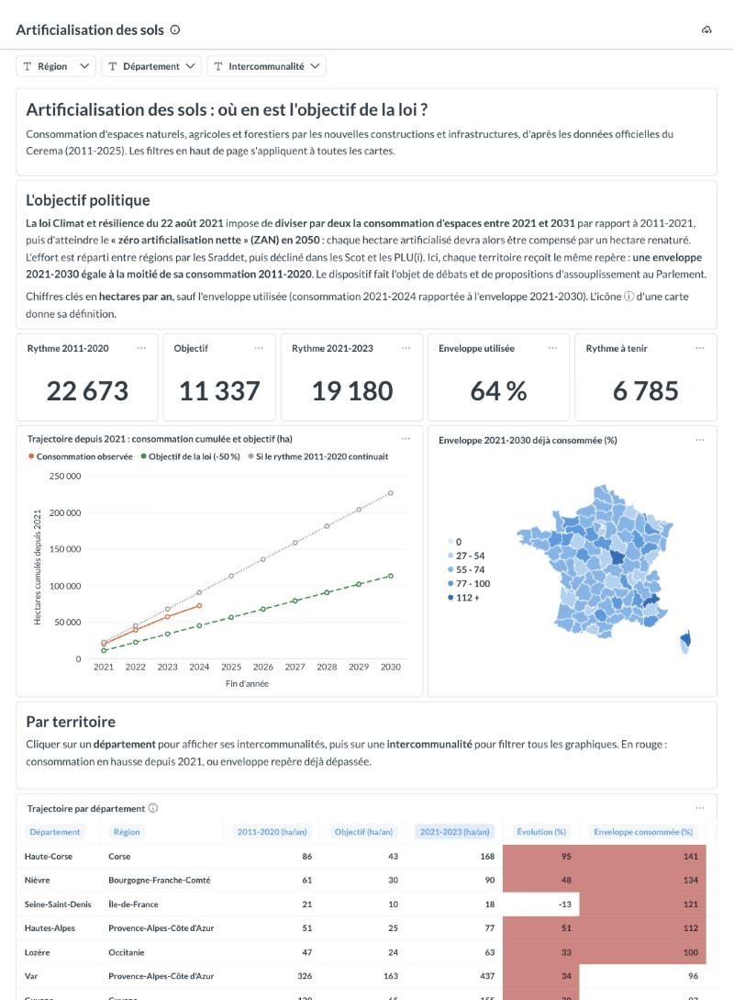
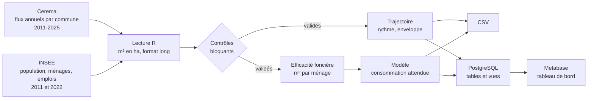
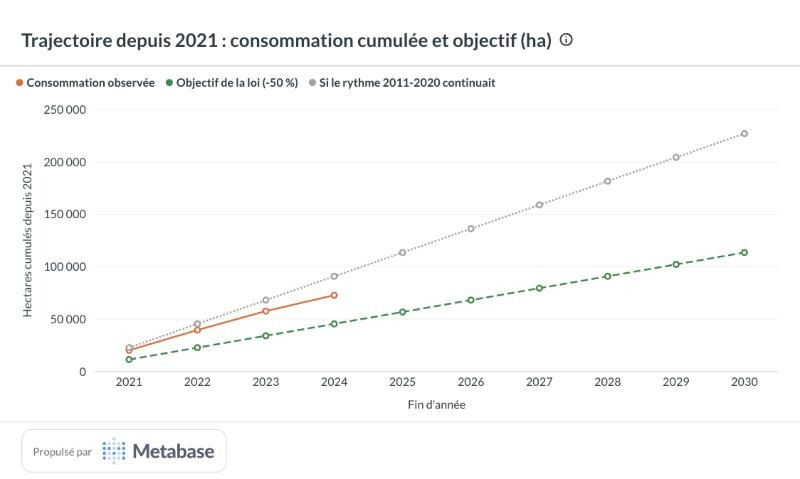
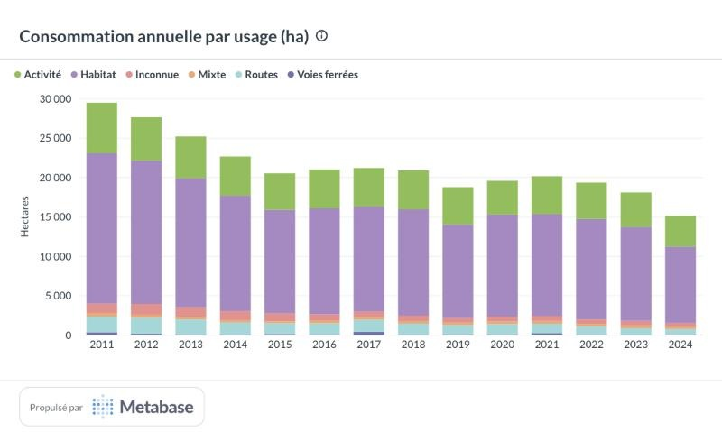
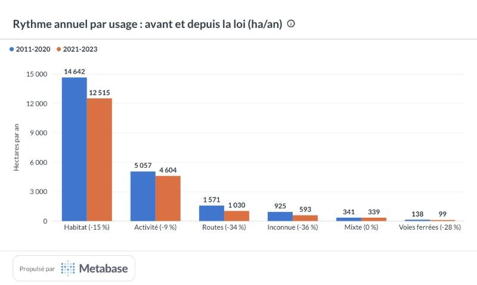
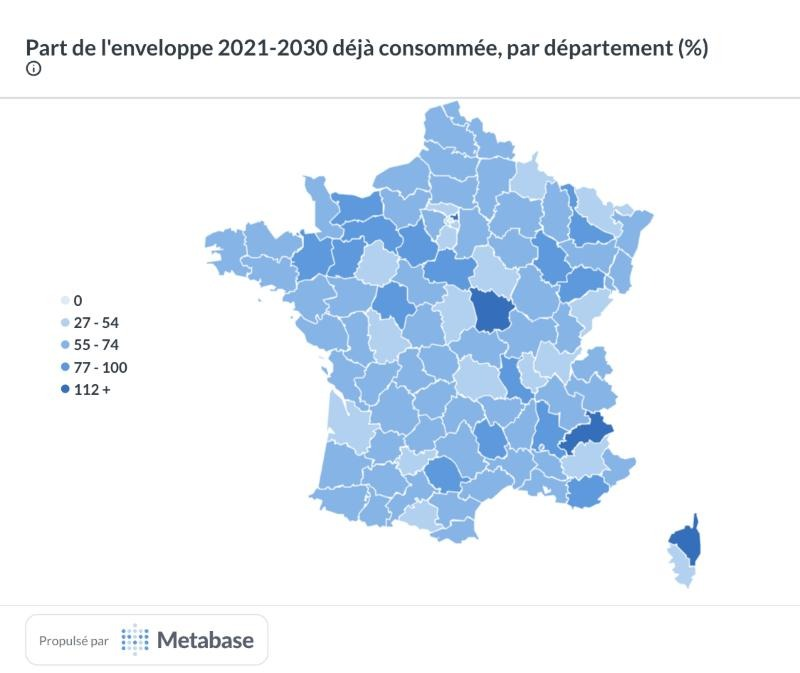
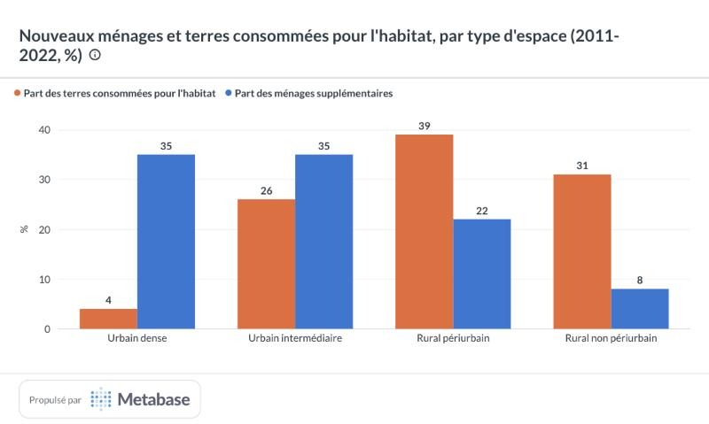
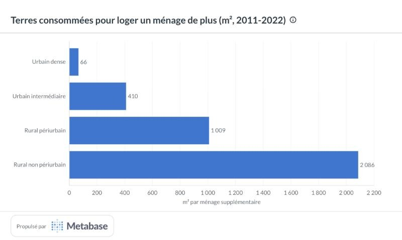
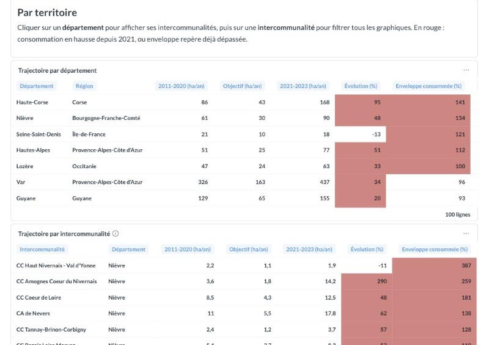

# Artificialisation des sols : où en est la trajectoire du « zéro artificialisation nette » ?

**Depuis 2021, la France consomme-t-elle deux fois moins d'espaces naturels, agricoles et forestiers, comme le prévoit la loi Climat et résilience ? Et qui consomme le plus de terres pour chaque ménage accueilli ?**

Ce projet exploite les données communales de consommation d'espaces du Cerema (2011-2025), qui intègrent les recensements de l'INSEE. Une chaîne R calcule la trajectoire de chaque territoire et son efficacité foncière, estime un modèle de consommation attendue, puis charge les résultats dans PostgreSQL pour un tableau de bord Metabase.

**[Ouvrir le tableau de bord Metabase en ligne](https://gauge-exclude-linking-greeting.trycloudflare.com/public/dashboard/71c3ec93-8a62-4354-8178-b6c518da95d6)** : filtrable par région, département et intercommunalité.

> Le tableau de bord est servi depuis un poste personnel par un tunnel Cloudflare : il peut être momentanément indisponible. Les captures ci-dessous en donnent un aperçu.



| Pour aller plus loin | |
|---|---|
| [Méthodologie](docs/METHODOLOGIE.md) | Indicateurs, modèle, contrôles et limites |
| [Récupérer les données](docs/DONNEES.md) | Le fichier à télécharger et où le déposer |
| [Tableau de bord Metabase](docs/METABASE.md) | Démarrage avec Docker, vues SQL, création automatique du tableau de bord |

> Résultats calculés le 24 novembre 2026 sur le millésime **2011-2025** du Cerema. L'année 2024 y est **sous-estimée** (le Cerema attend sa stabilisation dans deux à trois millésimes) : elle compte dans le cumul consommé, présenté comme une borne basse, mais pas dans le rythme.

## En bref

- La France a consommé **19 180 ha par an** en 2021-2023, contre 22 670 en 2011-2020 : **-15 %**, pour un objectif de -50 %.
- **64 % de l'enveloppe** 2021-2030 est déjà consommée en quatre ans, au minimum. Pour la tenir, il faudrait descendre à **6 800 ha par an** jusqu'en 2030, soit -70 % par rapport à la décennie de référence.
- Seuls **3 départements** sur 100 ont réduit leur rythme de moitié. **397 intercommunalités sur 1 251** consomment autant ou plus qu'avant 2021.
- Chaque ménage supplémentaire s'est accompagné de **66 m²** de terres consommées pour l'habitat en ville dense, contre **2 090 m²** dans le rural non périurbain. **29 %** des espaces consommés entre 2011 et 2022 l'ont été dans des communes qui perdaient des habitants.

## La méthode



1. **Lire.** Le fichier du Cerema donne, pour chaque commune, la surface consommée chaque année de 2011 à 2024 par destination (habitat, activité, mixte, routes, voies ferrées, inconnue), ainsi que la population, les ménages et les emplois des recensements 2011 et 2022.
2. **Contrôler.** Sept contrôles bloquants arrêtent la chaîne si les données sont incohérentes : codes uniques, flux positifs, somme des flux égale aux cumuls du Cerema, total égal à la somme des destinations, consommation inférieure à la surface communale.
3. **Mesurer la trajectoire.** Le rythme 2021-2023 est comparé au rythme 2011-2020. L'enveloppe de chaque territoire est la moitié de sa consommation 2011-2020 : c'est un repère homogène, pas l'enveloppe opposable fixée par les documents d'urbanisme.
4. **Mesurer l'efficacité.** Sur 2011-2022, la surface consommée est rapportée aux ménages et aux emplois gagnés.
5. **Modéliser.** Une régression linéaire relie la consommation de chaque commune à sa croissance, selon son type d'espace. Elle donne une consommation « attendue », comparée à l'observée par intercommunalité.

## Les résultats

### Une baisse trois fois trop lente



Depuis 2021, la consommation cumulée se situe entre les deux trajectoires, plus près de la poursuite du rythme 2011-2020 que de l'objectif. À la fin de 2024, la France avait déjà consommé 72 660 ha, alors que la trajectoire de l'objectif en prévoyait 45 350.



La consommation a nettement baissé entre 2011 et 2015, puis plafonné autour de 20 000 ha par an. Depuis 2021, elle recule de nouveau, mais lentement : 20 130 ha en 2021, 19 340 en 2022, 18 070 en 2023. Le chiffre de 2024 (15 120 ha) est provisoire et sera revu à la hausse.

| Indicateur | Valeur |
|---|---|
| Rythme 2011-2020 | 22 670 ha/an |
| Rythme 2021-2023 | 19 180 ha/an (-15 %) |
| Rythme visé par l'objectif de -50 % | 11 340 ha/an |
| Enveloppe 2021-2030 | 113 370 ha |
| Consommé 2021-2024 (borne basse) | 72 660 ha, soit 64 % de l'enveloppe |
| Rythme nécessaire en 2025-2030 | 6 780 ha/an |

### Une baisse inégale selon les usages



L'habitat représente 65 % de la consommation, avant comme après 2021, et son rythme baisse de 15 %. L'activité économique baisse moins (-9 %) : sa part passe de 22 % à 24 %. Les routes (-34 %) et les voies ferrées (-28 %) reculent nettement, mais pèsent peu.

### Presque aucun territoire sur la trajectoire



Seuls les Hauts-de-Seine, le Val-de-Marne et l'Yonne ont réduit leur rythme d'au moins moitié. Dix-neuf départements consomment plus qu'avant 2021, dont la Haute-Corse (+95 %), les Hautes-Alpes (+51 %) et la Nièvre (+48 %). Dans ces départements peu consommateurs, une grosse opération suffit à faire basculer le rythme : dans la Nièvre, une seule commune a consommé 30 ha en 2023, la moitié de ce que tout le département consommait chaque année avant 2021. Quatre départements ont déjà dépassé, dès 2024, l'enveloppe que leur donnerait une division par deux : la Haute-Corse, la Nièvre, la Seine-Saint-Denis et les Hautes-Alpes.

Aucune région n'approche l'objectif. Les plus avancées, La Réunion (-27 %) et l'Île-de-France (-25 %), en sont encore loin ; la Corse (+15 %) et la Guyane (+20 %) consomment davantage.

Les 397 intercommunalités stables ou en hausse pèsent 38 % de la consommation actuelle. 176 intercommunalités ont déjà consommé, en 2021-2024, plus que la moitié de leur consommation 2011-2020.

### Des terres consommées loin de la croissance

Pour mesurer l'efficacité foncière, on rapporte les terres consommées pour l'habitat entre 2011 et 2022 au nombre de **ménages supplémentaires** sur la même période (recensements de l'INSEE). Sur ces onze ans, la France a gagné 2,85 millions de ménages et consommé 159 000 ha pour l'habitat (247 000 ha tous usages confondus) : 560 m² de terres par ménage supplémentaire en moyenne. Ce chiffre ne mesure pas la taille des parcelles : il dit combien de terres naturelles, agricoles ou forestières ont été prises pour chaque ménage de plus, sachant qu'une partie des logements se construit sur des terrains déjà urbanisés.



L'urbain dense a accueilli 35 % des nouveaux ménages avec 4 % des terres consommées pour l'habitat ; le rural non périurbain, 8 % des nouveaux ménages avec 31 % de ces terres.



| Type d'espace (grille de densité INSEE) | Part des ménages supplémentaires | Part des terres consommées pour l'habitat | m² par ménage supplémentaire |
|---|---|---|---|
| Urbain dense | 35 % | 4 % | 66 |
| Urbain intermédiaire | 35 % | 26 % | 410 |
| Rural périurbain | 22 % | 39 % | 1 009 |
| Rural non périurbain | 8 % | 31 % | 2 086 |

La consommation ne suit pas toujours la croissance :

| Situation de la commune, 2011-2022 | Communes | Part de la consommation |
|---|---|---|
| Population et ménages en hausse | 18 617 | 71 % |
| Population en baisse, ménages en hausse | 9 444 | 21 % |
| Ménages en baisse ou stables | 6 795 | 8 % |

Dans 9 444 communes, la population baisse mais le nombre de ménages augmente : les ménages sont plus petits (décohabitation, vieillissement) et chacun occupe un logement. Ce desserrement explique une partie de la construction. Il reste 6 795 communes qui ont consommé 21 000 ha en perdant des ménages.

### Ce que dit le modèle

Le modèle explique 51 % des écarts de consommation entre communes (34 727 communes de métropole). À croissance égale, l'effet du type d'espace domine :

| Pour 100 ménages de plus | Hectares consommés |
|---|---|
| Urbain dense | 0,4 |
| Urbain intermédiaire | 2,1 |
| Rural périurbain | 7,1 |
| Rural non périurbain | 10,6 |

Dans le rural non périurbain et l'urbain intermédiaire, les communes qui perdent des ménages consomment aussi davantage que les autres : une partie de la consommation y répond à d'autres besoins que la démographie, que ce fichier ne permet pas d'identifier. Par intercommunalité, 137 consomment plus d'une fois et demie ce que prévoit le modèle, et 194 moins des deux tiers (sur celles dont la consommation attendue dépasse 20 ha). Ce ratio situe un territoire par rapport à des communes comparables ; il ne dit pas ce qu'il « aurait dû » consommer.

## Le tableau de bord Metabase

Le [tableau de bord en ligne](https://gauge-exclude-linking-greeting.trycloudflare.com/public/dashboard/71c3ec93-8a62-4354-8178-b6c518da95d6) reprend ces résultats en cinq parties : l'objectif fixé par la loi et les chiffres clés, la trajectoire depuis 2021 et la carte des départements, le détail par territoire, les usages, et l'efficacité foncière. Tous les graphiques de ce README en sont issus.

Les filtres Région, Département et Intercommunalité s'appliquent à toutes les cartes. Un clic sur un département dans le tableau affiche ses intercommunalités ; un clic sur une intercommunalité recalcule les chiffres clés et les graphiques pour elle seule.



Le script [`creer_tableau_de_bord.js`](metabase/creer_tableau_de_bord.js) crée tout le tableau de bord en une fois via l'API de Metabase ; voir [METABASE.md](docs/METABASE.md).

## Fichiers produits

| Fichier | Contenu |
|---|---|
| [`synthese_nationale.csv`](data/processed/synthese_nationale.csv) | Indicateurs France entière |
| [`serie_nationale.csv`](data/processed/serie_nationale.csv) | Consommation annuelle 2011-2024 par destination |
| [`trajectoire_regions.csv`](data/processed/trajectoire_regions.csv) | Trajectoire et efficacité par région |
| [`trajectoire_departements.csv`](data/processed/trajectoire_departements.csv) | Idem par département |
| [`trajectoire_epci.csv`](data/processed/trajectoire_epci.csv) | Idem par intercommunalité (1 251) |
| [`indicateurs_communes.csv`](data/processed/indicateurs_communes.csv) | Idem par commune (34 856) |
| [`efficacite_densite.csv`](data/processed/efficacite_densite.csv) | Efficacité foncière selon la grille de densité |
| [`consommation_selon_croissance.csv`](data/processed/consommation_selon_croissance.csv) | Consommation selon l'évolution de la population et des ménages |
| [`modele_coefficients.csv`](data/processed/modele_coefficients.csv) | Coefficients du modèle |
| [`modele_ecarts_epci.csv`](data/processed/modele_ecarts_epci.csv) | Consommation observée et attendue par intercommunalité |
| [`rapport_qualite.json`](data/processed/rapport_qualite.json) | Contrôles, diagnostics et qualité du modèle |

## Reproduire

Prérequis : R 4.3 ou plus. Pour le tableau de bord : Docker (PostgreSQL/PostGIS et Metabase).

```bash
Rscript installer.R
```

Déposer le fichier du Cerema selon [DONNEES.md](docs/DONNEES.md), puis :

```bash
Rscript run.R resultats
```

| Étape | Commande | Rôle |
|---|---|---|
| `resultats` | `Rscript run.R resultats` | Lecture, contrôles, indicateurs, modèle, CSV |
| `base` | `Rscript run.R base` | Résultats, puis chargement dans PostgreSQL pour Metabase |

Pour le tableau de bord, voir [METABASE.md](docs/METABASE.md) :

```bash
docker compose up -d
cp .Renviron.example .Renviron
Rscript run.R base
```

Puis, une fois le compte Metabase créé sur <http://localhost:3000>, exécuter `metabase/creer_tableau_de_bord.js` dans la console du navigateur.

Les tests, sur un petit fichier synthétique au format du Cerema :

```bash
Rscript tests/testthat.R
```

## Structure

```text
run.R              Point d'entrée : enchaîne les étapes
R/                 Configuration, lecture, contrôles, indicateurs, modèle, exports, base
sql/               Vues PostgreSQL lues par Metabase
metabase/          Script de création du tableau de bord (API Metabase)
tests/             Tests unitaires (testthat) sur données synthétiques
docs/              Méthodologie, guide des données, guide Metabase, captures du tableau de bord
data/reference/    Contours simplifiés des départements (carte Metabase)
data/processed/    Résultats
```

Chaque script commence par un en-tête qui explique son rôle, ce qu'il lit et ce qu'il produit.

## Limites

- L'enveloppe de chaque territoire applique la même réduction de 50 %. Les enveloppes réelles sont territorialisées par les Sraddet, Scot et PLU(i), et la loi prévoit des décomptes particuliers (projets d'envergure nationale ou européenne notamment).
- Les Fichiers fonciers décrivent le cadastre fiscal : certains équipements publics, non soumis à la taxe foncière, y sont mal couverts.
- La consommation est datée du début de l'aménagement : une zone d'activité ouverte en 2022 compte entièrement en 2022, même si elle se remplit ensuite.
- L'efficacité porte sur 2011-2022, période des recensements disponibles dans le fichier : elle ne dit rien de l'efficacité depuis 2021.
- Le modèle est descriptif. Il ne tient compte ni des prix du foncier, ni des documents d'urbanisme, ni des projets d'infrastructure.

## Pistes d'amélioration

- **Croiser avec le prix des terrains à bâtir** (DVF) pour mesurer l'effet de la sobriété foncière sur le marché.
- **Comparer à l'artificialisation mesurée par l'OCS GE** de l'IGN, à mesure que les départements disposent de deux millésimes comparables.
- **Intégrer les logements vacants** (LOVAC) pour distinguer les territoires qui construisent malgré un parc vacant important.
- **Remplacer l'enveloppe uniforme** par les enveloppes régionales des Sraddet, là où elles sont publiées.

## Sources

| Source | Producteur | Licence |
|---|---|---|
| [Consommation d'espaces naturels, agricoles et forestiers 2011-2025](https://www.data.gouv.fr/datasets/consommation-despaces-naturels-agricoles-et-forestiers-du-1er-janvier-2011-au-1er-janvier-2025) | Cerema, DGALN (Fichiers fonciers, DGFiP) ; données socio-économiques INSEE | Licence Ouverte 2.0 |
| [Contours des départements](https://github.com/gregoiredavid/france-geojson) | Grégoire David, d'après IGN Admin Express | Licence Ouverte |

## Licence

Code sous licence [MIT](LICENSE). Les données restent soumises à la licence de leur producteur.
