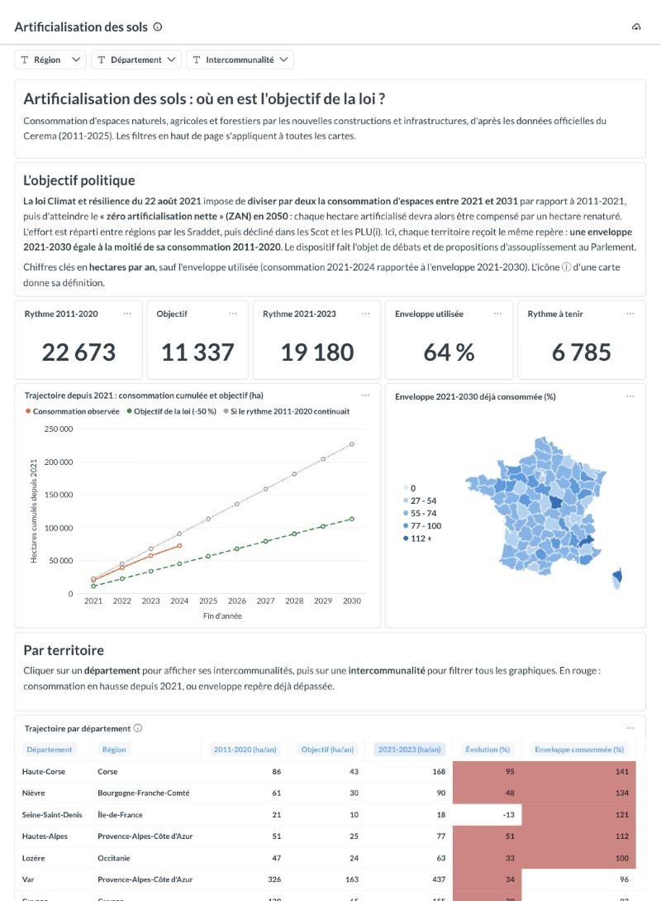
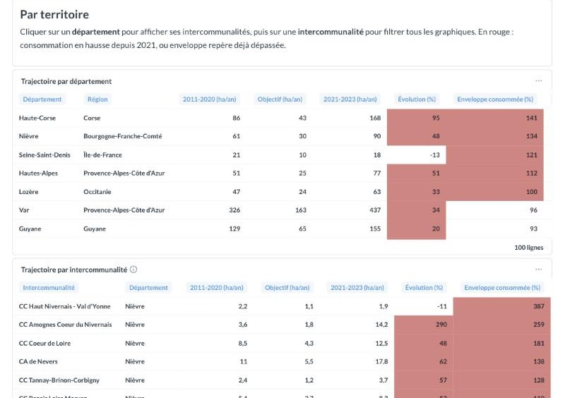

# Tableau de bord Metabase

Le tableau de bord lit les tables et les vues que `Rscript run.R base` crée dans PostgreSQL. Il est créé en une fois par [`metabase/creer_tableau_de_bord.js`](../metabase/creer_tableau_de_bord.js), qui contient aussi le SQL de chaque question.

## 1. Démarrer PostgreSQL et Metabase

```bash
docker compose up -d
```

PostgreSQL écoute sur `localhost:5432` (base `artificialisation`, utilisateur `postgres`, mot de passe `artif`) et Metabase sur <http://localhost:3000>. La configuration de Metabase (comptes, questions, tableaux de bord) est conservée dans `metabase/donnees/`, qui n'est pas versionné.

## 2. Charger les données

```bash
cp .Renviron.example .Renviron
Rscript run.R base
```

L'étape recalcule tout, puis écrit huit tables et cinq vues dans le schéma `artif`, dont 2,9 millions de lignes de flux annuels (commune × année × destination). Compter une à deux minutes.

| Vue | Contenu |
|---|---|
| `v_chiffres_cles` | Une ligne : rythmes, enveloppe, part consommée, rythme requis |
| `v_flux_annuel` | Flux annuels par commune et destination, avec région, département, EPCI et période |
| `v_trajectoire_epci` | Trajectoire, efficacité et écart au modèle par intercommunalité |
| `v_trajectoire_departement` | Trajectoire par département, pour la carte |
| `v_communes` | Trajectoire et croissance par commune |

## 3. Créer le compte Metabase

Au premier lancement, Metabase demande de créer un compte administrateur. À l'étape « Ajouter vos données », choisir « J'ajouterai mes données plus tard » : le script de l'étape suivante connecte la base.

## 4. Créer le tableau de bord

Une fois connecté à Metabase, ouvrir la console du navigateur (Cmd+Option+J dans Chrome), coller le contenu de [`metabase/creer_tableau_de_bord.js`](../metabase/creer_tableau_de_bord.js) et valider. Le script passe par l'API de Metabase pour :

- connecter la base PostgreSQL (schéma `artif` uniquement) et attendre sa synchronisation ;
- déclarer la carte des départements (GeoJSON de ce dépôt, clé `code`) et le format français des nombres ;
- créer une collection « Artificialisation des sols » et ses treize questions en SQL natif (une version précédente est archivée) ;
- monter le tableau de bord, ses trois filtres (Région, Département, Intercommunalité) et le filtrage au clic dans les tableaux.

Si Metabase ne tourne pas dans le même `docker compose` que PostgreSQL, adapter l'hôte dans `CONFIG` en tête du script.

## 5. Ce que contient le tableau de bord



| Partie | Cartes |
|---|---|
| L'objectif politique | Texte sur la loi Climat et résilience et le ZAN ; chiffres clés : rythme 2011-2020, objectif, rythme 2021-2023, part de l'enveloppe utilisée, rythme à tenir en 2025-2030 |
| Trajectoire | Consommation cumulée depuis 2021, comparée à la trajectoire de l'objectif et à la poursuite du rythme 2011-2020 ; carte de l'enveloppe consommée par département |
| Par territoire | Tableau des départements, puis tableau des intercommunalités, avec objectif, évolution et enveloppe consommée |
| Par usage | Rythme annuel de chaque usage avant et depuis la loi ; consommation annuelle par usage |
| Efficacité foncière | Part des nouveaux ménages et des terres consommées pour l'habitat par type d'espace ; terres consommées par ménage supplémentaire |

Tous les chiffres et graphiques se recalculent pour le territoire filtré, sauf la carte (filtrée par région seulement). Un clic sur un département dans le tableau renseigne le filtre Département ; un clic sur une intercommunalité renseigne le filtre Intercommunalité.



Les captures de ce dépôt viennent des liens publics des questions (`/public/question/…`), affichés à 900 px de large en thème clair.

## 6. Mettre à jour

À chaque nouveau millésime du Cerema : remplacer `data/raw/conso-com.csv`, ajuster les années dans `R/config.R` si besoin, relancer `Rscript run.R base`. Les questions Metabase n'ont pas à être modifiées.

## 7. Mettre en ligne

Le tableau de bord est publié depuis un Mac par un tunnel Cloudflare, gratuit et sans compte :

```bash
docker run -d --name artif-tunnel --restart unless-stopped cloudflare/cloudflared:latest \
  tunnel --no-autoupdate --url http://host.docker.internal:3000
docker logs artif-tunnel 2>&1 | grep trycloudflare
```

La dernière commande affiche l'adresse publique (`https://….trycloudflare.com`). Dans Metabase :

1. Administration → Paramètres → Général : renseigner cette adresse comme « Adresse du site ».
2. Administration → Paramètres → Partage public : activer le partage public.
3. Sur le tableau de bord, menu Partager → Lien public : copier le lien.

Limites : le lien ne fonctionne que lorsque le Mac est allumé avec Docker lancé, et l'adresse change si le conteneur `artif-tunnel` est recréé. Seuls le tableau de bord et ses questions sont publics ; le reste de Metabase demande toujours une connexion. Pour une adresse fixe, il faut un tunnel nommé (compte Cloudflare et nom de domaine) ou un hébergement sur un serveur.
