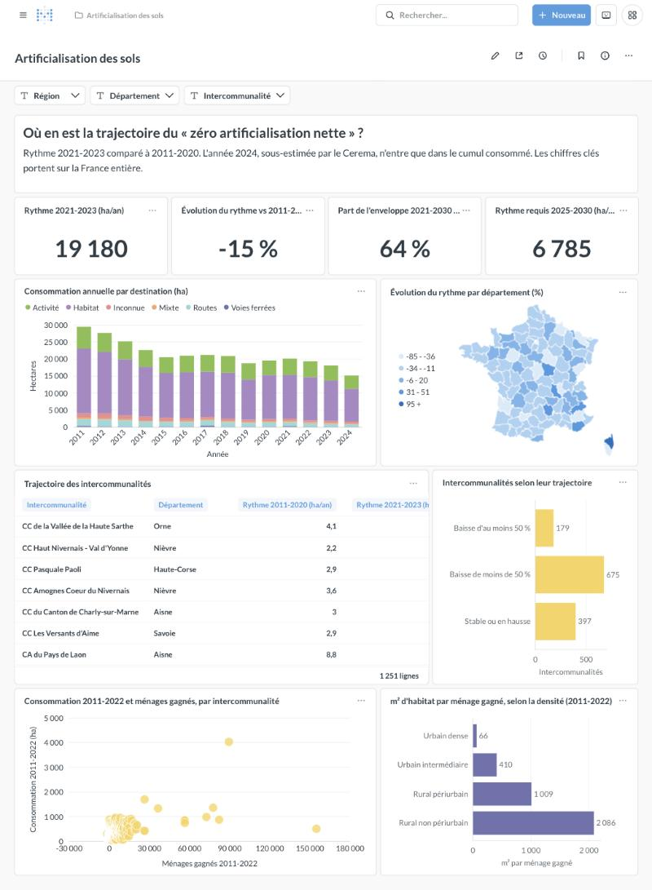
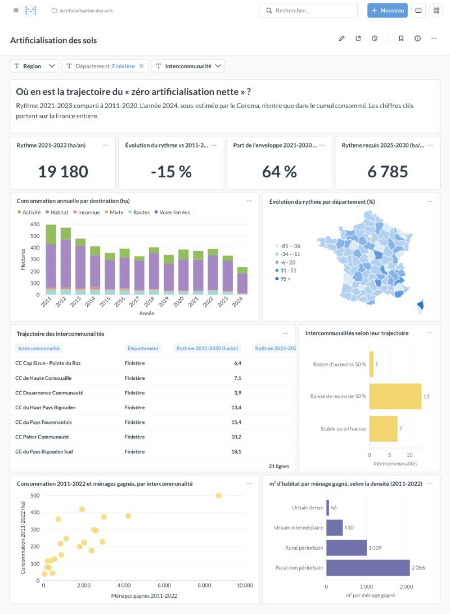

# Tableau de bord Metabase

Le tableau de bord lit les vues que `Rscript run.R base` crée dans PostgreSQL. Toutes les requêtes sont dans [`metabase/questions.sql`](../metabase/questions.sql).

## 1. Démarrer PostgreSQL et Metabase

```bash
docker compose up -d
```

PostgreSQL écoute sur `localhost:5432` (base `artificialisation`, utilisateur `postgres`, mot de passe `artif`) et Metabase sur <http://localhost:3000>. La configuration de Metabase (comptes, questions, tableaux de bord) est conservée dans `metabase/donnees/`, qui n'est pas versionné.

## 2. Charger les données

```bash
cp .Renviron.example .Renviron
Rscript run.R base
```

L'étape recalcule tout, puis écrit huit tables et cinq vues dans le schéma `artif`, dont 2,9 millions de lignes de flux annuels (commune × année × destination). Compter une à deux minutes.

| Vue | Contenu |
|---|---|
| `v_chiffres_cles` | Une ligne : rythmes, enveloppe, part consommée, rythme requis |
| `v_flux_annuel` | Flux annuels par commune et destination, avec région, département, EPCI et période |
| `v_trajectoire_epci` | Trajectoire, efficacité et écart au modèle par intercommunalité |
| `v_trajectoire_departement` | Trajectoire par département, pour la carte |
| `v_communes` | Trajectoire et croissance par commune |

## 3. Créer le compte Metabase

Au premier lancement, Metabase demande de créer un compte administrateur. À l'étape « Ajouter vos données », choisir « J'ajouterai mes données plus tard » : le script de l'étape suivante connecte la base.

## 4. Créer le tableau de bord

Une fois connecté à Metabase, ouvrir la console du navigateur (Cmd+Option+J dans Chrome), coller le contenu de [`metabase/creer_tableau_de_bord.js`](../metabase/creer_tableau_de_bord.js) et valider. Le script passe par l'API de Metabase pour :

- connecter la base PostgreSQL (schéma `artif` uniquement) et attendre sa synchronisation ;
- déclarer la carte des départements (GeoJSON de ce dépôt, clé `code`) ;
- créer une collection « Artificialisation des sols » et ses dix questions en SQL natif ;
- monter le tableau de bord, avec trois filtres reliés aux questions : Région, Département, Intercommunalité ;
- régler l'affichage des nombres au format français.

Si Metabase ne tourne pas dans le même `docker compose` que PostgreSQL, adapter l'hôte dans `CONFIG` en tête du script.

## 5. Ce que contient le tableau de bord



| Carte | Contenu | Filtres |
|---|---|---|
| Chiffres clés | Rythme 2021-2023, évolution, part de l'enveloppe consommée, rythme requis (France entière) | aucun |
| Consommation annuelle | Hectares par année et par destination | Région, Département, Intercommunalité |
| Carte | Évolution du rythme par département | Région |
| Trajectoire des intercommunalités | Rythmes, évolution, enveloppe, efficacité, ratio observé / attendu ; en rouge les hausses et les enveloppes dépassées | Région, Département, Intercommunalité |
| Intercommunalités selon leur trajectoire | Nombre d'EPCI par statut | Région, Département |
| Consommation et ménages gagnés | Une intercommunalité par point, 2011-2022 | Région, Département |
| m² par ménage gagné | Selon la grille de densité de l'INSEE | aucun |

Filtré sur le Finistère :



Les requêtes de chaque carte sont aussi lisibles dans [`metabase/questions.sql`](../metabase/questions.sql), sous une forme à recopier à la main si besoin.

## 6. Mettre à jour

À chaque nouveau millésime du Cerema : remplacer `data/raw/conso-com.csv`, ajuster les années dans `R/config.R` si besoin, relancer `Rscript run.R base`. Les questions Metabase n'ont pas à être modifiées.
